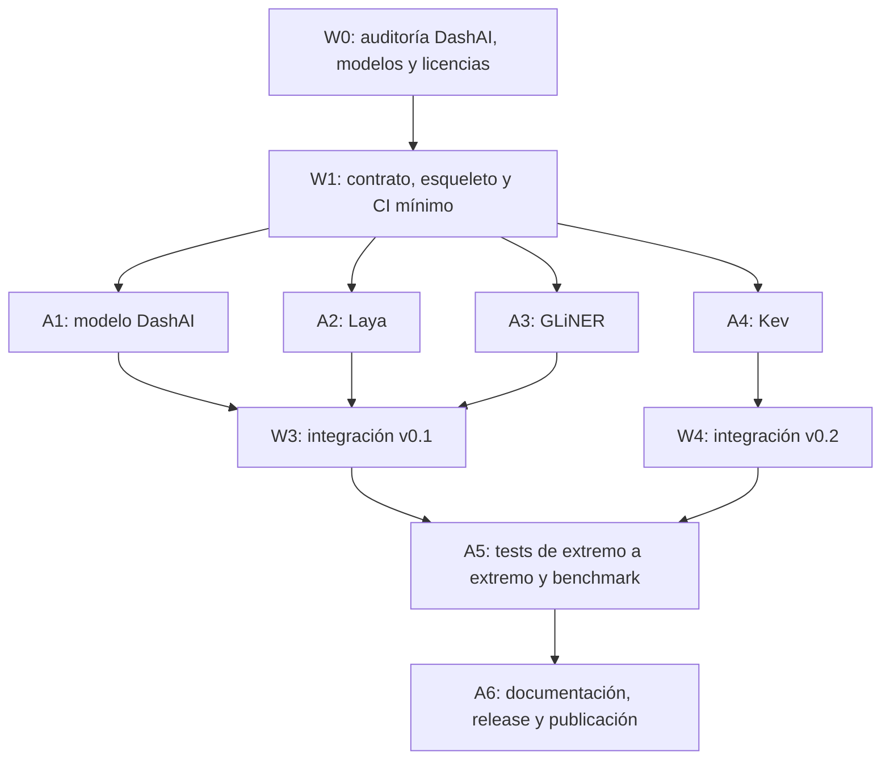

# Plan multiagente para `dashai-system-one-plugin`

**Proyecto:** integración de modelos System One abiertos en DashAI  
**Entorno de desarrollo:** Orca (https://www.onorca.dev/) + Git + Python  
**Estado:** plan de implementación, no software ya implementado  
**Fecha de referencia:** 27 de octubre de 2026

## 1. Objetivo y restricciones innegociables

Crear un plugin instalable de DashAI que permita **descargar, cargar localmente, evaluar y comparar modelos System One de decisiones tipadas**. Debe aprovechar el diseño de registro de plugins utilizado en `dashai_vision_language_plugin`, sin confundir decisiones neuronales con optimización matemática.

### Requisitos obligatorios

1. **Solo modelos abiertos:** pesos accesibles y descargables, código/inferencia accesibles, licencia permisiva comprobada para el checkpoint y sus dependencias. Revisar las condiciones específicas de cada versión antes de publicar.
2. **Inferencia local:** CPU, CUDA y/o Apple Silicon (MPS/MLX) cuando sea compatible. Sin dependencia obligatoria de proveedores de inferencia remotos. Un servidor HTTP en `127.0.0.1` es aceptable si toda la inferencia ocurre localmente.
3. **Descarga explícita y caché:** elegir checkpoint/revisión, permitir reutilizar pesos existentes y trabajar sin conexión después de descargar todos los artefactos requeridos.
4. **Contrato unificado:** entradas `state` + `questions`; salidas tipadas `choice`, `score` y `noul` **solo si el backend las soporta**. Nunca simular probabilidades o niveles de confianza ausentes.
5. **Integración real con DashAI:** que los componentes aparezcan en la UI, sean ejecutables y permitan evaluación sobre datasets; evitar modificar el núcleo en el MVP salvo que sea imprescindible.
6. **Calidad y reproducibilidad:** pruebas automatizadas, versiones fijadas, documentación y resultados comparables.
7. **No Jev ni APIs propietarias.** Tampoco incluir modelos cuya licencia sea incompatible con el criterio anterior.

### Fuera del MVP

- Entrenar modelos System One desde cero.
- Hacer fine-tuning de los checkpoints (documentar el camino, implementar después).
- Desarrollar una interfaz gráfica completamente nueva para DashAI.
- Crear una `SystemOneTask` en el núcleo antes de demostrar que el MVP funciona mediante `TextClassificationTask`.
- Usar datos clínicos reales o información personal sensible en las pruebas.

## 2. Modelos y prioridad

| Checkpoint / familia | Motor local | Primer soporte | Hito |
|---|---|---|---|
| [`convaiinnovations/laya`](https://huggingface.co/convaiinnovations/laya) | SDK `laya`, `Router` | `choice`, más `score`/`noul` mediante contrato nativo | v0.1 |
| [`convaiinnovations/laya-multilingual`](https://huggingface.co/convaiinnovations/laya-multilingual) | Mismo backend Laya | Multilingüe | v0.1 |
| [`fastino/GLiNER2.5-Decide`](https://huggingface.co/fastino/GLiNER2.5-Decide) | `gliner2.AutoExtractor` | Clasificación por etiquetas; capacidades tipadas verificadas individualmente | v0.1 |
| [`fastino/GLiNER2.5-multi-Decide`](https://huggingface.co/fastino/GLiNER2.5-multi-Decide) | Mismo backend GLiNER2 | Multilingüe | v0.1 |
| [`jaredpalmer/kev-0.8b`](https://huggingface.co/jaredpalmer/kev-0.8b) | Runtime Kev local (incluido cabezal especial y modelo base Qwen) | `choice`, `score`, `noul` según API documentada | v0.2 |

**Atención con Kev:** los pesos en Hugging Face incluyen un adaptador y un cabezal sobre `Qwen/Qwen3.5-0.8B-Base`; cargar solamente el LoRA mediante Transformers no reproduce su sistema de decisiones. Para el primer adaptador, utilizar el runtime oficial Kev en un proceso **local** y exponerlo al plugin por loopback, verificando versiones y apagado seguro. No hacer llamadas a servicios externos.

**Atención con GLiNER:** la API de clasificación no debe tratarse automáticamente como una API `choice`/`score`/`noul` idéntica a Laya o Kev. Si una respuesta expone solamente una etiqueta, marcar `probabilities_available=false` y deshabilitar las métricas que exigen probabilidades.

## 3. Arquitectura del plugin

```text
dashai-system-one-plugin/
├── pyproject.toml
├── README.md
├── LICENSE
├── AGENTS.md                      # instrucciones comunes para agentes
├── docs/
│   ├── architecture.md
│   ├── local-models.md
│   ├── compatibility.md
│   └── benchmark-protocol.md
├── src/dashai_system_one_plugin/
│   ├── __init__.py
│   ├── core/
│   │   ├── contracts.py            # Questions, Decisions, capabilities
│   │   ├── base_backend.py
│   │   ├── checkpoint_registry.py
│   │   └── device.py
│   ├── backends/
│   │   ├── laya_backend.py
│   │   ├── gliner_backend.py
│   │   └── kev_backend.py
│   ├── models/
│   │   ├── base_dashai_system_one.py
│   │   ├── laya_text_classifier.py
│   │   ├── gliner_text_classifier.py
│   │   └── kev_text_classifier.py
│   ├── metrics/
│   └── utils/
├── tests/
│   ├── unit/
│   ├── contract/
│   └── integration/               # descargas reales opcionales
└── examples/
    ├── routing_sample.csv
    └── local_inference.py
```

### 3.1 Contrato único, independiente de DashAI

El agente arquitecto debe congelar primero un contrato lógico semejante al siguiente (los nombres definitivos se decidirán tras inspeccionar las APIs de DashAI):

```python
from typing import Literal
from pydantic import BaseModel

class QuestionSpec(BaseModel):
    type: Literal["choice", "score", "noul"]
    instructions: str
    criteria: dict[str, str] | list[str] | None = None

class DecisionSpec(BaseModel):
    state: str | dict
    questions: dict[str, QuestionSpec]

class DecisionAnswer(BaseModel):
    kind: Literal["choice", "score", "noul"]
    value: str | float | bool
    probabilities: dict[str, float] | None = None
    calibrated: bool | None = None

class DecisionResult(BaseModel):
    answers: dict[str, DecisionAnswer]
    model_id: str
    revision: str | None = None
```

**Invariantes:** correspondencia entre nombres y orden de alternativas, no hay NaN/Inf, probabilidades dentro de `[0,1]` cuando existen, suma aproximadamente 1 solo para `choice` mutuamente excluyente, salidas deterministas bajo configuración determinista cuando el backend lo permite, manejo explícito de etiquetas desconocidas y preguntas no compatibles.

La interfaz `BaseSystemOneBackend` debe exponer `load()`, `predict(spec)`, `unload()` y `capabilities()`. La descarga y resolución del checkpoint debe estar separada de la predicción. Errores tipados para dependencia faltante, checkpoint ausente, OOM, pregunta no compatible y configuración inválida.

### 3.2 Primer punto de entrada a DashAI: clasificación de texto

La versión 0.1 debe registrar clases específicas para **Laya Text Classification** y **GLiNER Decide Text Classification** bajo `dashai.plugins` en `pyproject.toml`.

- Aprovechar `TextClassificationTask`: una columna de texto de entrada, una etiqueta categórica de salida.
- `train(...)` puede preparar etiquetas, preguntas fijas y checkpoint para un modelo zero-shot, **sin representar falsamente que se ajustaron pesos**.
- `predict(...)` debe devolver `N × K` probabilidades cuando el backend las proporciona; si no existen, el adaptador debe decidir explícitamente entre una implementación compatible basada en decisiones categóricas y una ruta alternativa, sin inventar confianza.
- Implementar `save()` y `load()` conservando revisión de pesos, mapeo ordenado de clases, pregunta/criterios, configuración de backend y versión de contrato. No almacenar ni publicar accidentalmente checkpoints grandes.
- Mover las preguntas múltiples y las salidas tipadas no clasificatorias a una extensión posterior `SystemOneTask` **solo si** el flujo actual de DashAI no las soporta apropiadamente.

La compatibilidad real se verificará contra `DashAI.back.models.base_model.BaseModel`, `TextClassificationTask`, `ClassificationTask`, el pipeline y la instalación de plugins del commit fijado.

### 3.3 Dependencias opcionales

```text
pip install dashai-system-one-plugin[laya]
pip install dashai-system-one-plugin[gliner]
pip install dashai-system-one-plugin[all]
```

Estas son **interfaces de instalación propuestas**, no comandos disponibles antes de publicar el paquete. Kev puede necesitar instrucciones y runtime opcional separado si su distribución no resulta compatible con una instalación Python directa.

## 4. Diseño multiagente para Orca

Orca utilizado: **https://www.onorca.dev/** (no confundir con otros productos llamados Orca). Usar *worktrees* independientes y la orquestación nativa de **Runs → Tasks → supervised workers → mensajes/decision gates**.

### 4.1 Agentes, roles y propiedad de archivos

| ID | Rol | Agente CLI sugerido | Responsabilidad principal | Archivos bajo su propiedad |
|---|---|---|---|---|
| A0 | **Coordinator / Tech Lead** | Claude Code o Codex (alta capacidad) | Especificación, contratos, dependencias, integración de PR y decisiones de alcance | `AGENTS.md`, `docs/architecture.md`, backlog |
| A1 | **DashAI Compatibility** | Codex | Auditar `BaseModel`, tareas, registro, compatibilidad frontend y componentes | `src/.../models/`, integración DashAI |
| A2 | **Laya Backend** | Claude Code | Adapter local Laya, inglés/multilingüe, pruebas unitarias | `src/.../backends/laya_backend.py`, tests de Laya |
| A3 | **GLiNER Backend** | Gemini CLI | Adapter GLiNER, soporte real de scoring/etiquetas, pruebas | `src/.../backends/gliner_backend.py`, tests GLiNER |
| A4 | **Kev Backend** | Codex | Investigar/implementar proceso local Kev, adapter/compatibilidad, pruebas | `src/.../backends/kev_backend.py`, tests Kev |
| A5 | **Quality & Security** | Claude Code o Codex, independiente de A2–A4 | Contratos, test suite, offline, seguridad, CI, evaluación y benchmarks | `tests/contract/`, `docs/benchmark-protocol.md`, `.github/` |
| A6 | **Docs & Release** | Gemini CLI | README, tutorial de usuario, packaging, licencias y PyPI | `README.md`, `docs/local-models.md`, `examples/` |

**Regla de coordinación:** los agentes trabajan en branches y worktrees diferentes. No modifican contratos congelados ni archivos ajenos sin avisar al coordinador. Cada tarea entrega PR o commit aislado y evidencia de pruebas. El coordinador hace el merge secuencial. No se permite que un agente integre a `main` sin revisión.

### 4.2 Grafo de dependencias



**Máximo sugerido de trabajo concurrente:** 3 o 4 workers de implementación; A5 revisa los resultados antes del merge. A4 (Kev) puede continuar en paralelo sin bloquear v0.1.

## 5. Fases y tareas delegables

### W0 — Auditoría y decisiones de diseño (A0 + A1 + A5)

**Entregables:** `docs/architecture.md`, `docs/compatibility.md`, versión mínima DashAI fijada, matriz de capacidades y licencias, lista de riesgos.

- [ ] Inspeccionar repositorio [`DashAISoftware/dashAI`](https://github.com/DashAISoftware/dashAI): clase `BaseModel`, `TextClassificationTask`, entry points, métricas, `save/load`, frontend, dependencias y CI.
- [ ] Inspeccionar plugin de referencia [`diegoolguinw/dashai_vision_language_plugin`](https://github.com/diegoolguinw/dashai_vision_language_plugin), especialmente el patrón de `pyproject.toml`, `BaseModel` y registro de clases.
- [ ] Hacer *spikes* pequeños de inferencia real para Laya, GLiNER y Kev (separados de la integración DashAI).
- [ ] Verificar licencia exacta del código, checkpoint, tokenizer, modelo base y librerías. Guardar URL y revisión/commit.
- [ ] Decidir cómo representar `choice` sin probabilidades para los backends que solo devuelven etiquetas.
- [ ] Escribir ADR-001 (alcance v0.1), ADR-002 (contrato), ADR-003 (Kev local).

**Gate G0:** no se empieza a implementar adapters hasta aprobar contrato, matriz de capacidades y política de versiones.

### W1 — Contrato, esqueleto, pruebas falsas (A0 + A5)

- [ ] Crear repositorio nuevo y licencia compatible.
- [ ] Crear paquete en `src/`, `pyproject.toml`, `AGENTS.md` y extras opcionales.
- [ ] Escribir `DecisionSpec`, `DecisionResult`, `BaseSystemOneBackend` y `CheckpointRegistry`.
- [ ] Definir checkpoint IDs **fijos por clase visible** y revisiones configurables de manera controlada, siguiendo el patrón del plugin de CLIP.
- [ ] Implementar un `FakeBackend` para probar sin descargas ni GPU.
- [ ] Habilitar `pytest`, `ruff` y workflows de CI mínimos.

**Gate G1:** los contratos pasan tests sin instalar PyTorch o bajar pesos.

### W2 — Backends en paralelo (A2, A3, A4)

**A2 — Laya:**

- [ ] Usar la API documentada `from laya import Router` y `Router().predict(state, questions)`; no asumir que existe `laya.load()`.
- [ ] Exponer configuraciones de checkpoint, dispositivo, lote y límite de tokens según soporte real.
- [ ] Preservar las probabilidades y metadatos de routing.
- [ ] Tests mock, errores e inferencia opcional con checkpoint real.

**A3 — GLiNER:**

- [ ] Utilizar `from gliner2 import AutoExtractor` y `AutoExtractor.from_pretrained(...)`.
- [ ] Confirmar formas concretas de `classify_text` y soporte para textos y conjuntos arbitrarios de etiquetas.
- [ ] Documentar capacidades por variante. No afirmar que `score`/`noul` producen el mismo objeto que Laya hasta comprobarlo.
- [ ] Evitar convertir predicciones duras en probabilidades aparentemente calibradas.
- [ ] Tests mock e integración local optativa.

**A4 — Kev:**

- [ ] Fijar revisión de `jaredpalmer/kev` y del checkpoint/base Qwen.
- [ ] Probar runtime oficial con la configuración documentada, iniciado manualmente sobre `127.0.0.1`.
- [ ] Crear adapter Python que consuma **solo** `http://127.0.0.1:<puerto>` y rechace direcciones externas en modo local estricto.
- [ ] Validar `choice`, `score`, `noul`, timeouts, modelo caído y memoria.
- [ ] Evaluar después si conviene empotrar el motor en proceso; no bloquear v0.1.

**Gate G2:** cada backend demuestra predicción local correcta en un ejemplo fijo y pruebas unitarias independientes.

### W3 — Integración DashAI v0.1 (A1 + A5)

- [ ] Registrar Laya y GLiNER inglés/multilingüe como componentes en `dashai.plugins`.
- [ ] Crear clases específicas de clasificación de texto; usar checkpoint fijo y configuración validada.
- [ ] Implementar `train()`, `predict()`, `save()` y `load()` conforme a DashAI.
- [ ] Verificar en interfaz: instalar plugin → crear experimento → elegir modelo → configurar labels → ejecutar → evaluar.
- [ ] Confirmar que el flujo devuelve `N × K` de manera consistente o que existe tratamiento explícito de backend sin probabilidades.
- [ ] Evaluar en un CSV sintético de tickets en español/inglés.

**Gate G3 / Release v0.1:** instalación limpia, modelo visible en UI, predicción, evaluación y guardado/carga; sin modificaciones obligatorias al core de DashAI.

### W4 — Kev y decisiones tipadas v0.2 (A4 + A1 + A5)

- [ ] Integrar Kev como opción de runtime local avanzada.
- [ ] Soportar varias preguntas por estado a través de API Python propia del plugin.
- [ ] Evaluar un nuevo componente `SystemOneTask` solo si hay necesidad demostrada y contrato estable.
- [ ] Si requiere modificar DashAI, abrir PR **separado** con migración compatible hacia atrás.
- [ ] Añadir benchmark reproducible de latencia y calibración.

**Gate G4 / Release v0.2:** Kev ejecuta inferencia en localhost sin servicio cloud y no rompe los caminos Laya/GLiNER.

### W5 — Documentación y release (A6 + A5 + A0)

- [ ] Documentar instalación por modelo, tamaños de checkpoint, hardware probado y modo offline.
- [ ] Crear tutorial con datos sintéticos e imágenes de la UI real.
- [ ] Completar matriz `backend × device × output_type × feature`.
- [ ] Documentar amenazas: acceso a red, código remoto, privacidad, OOM, alteración de revision de pesos.
- [ ] Publicar solo cuando pasen CI y pruebas manuales de aceptación.
- [ ] Etiquetar versión, generar changelog y publicar en PyPI si se autoriza.

## 6. Cómo ejecutar el plan en Orca

### 6.1 Preparación de Orca

1. Abrir Orca y agregar el repositorio local del plugin con **Add Repo**.
2. Configurar las sesiones de Claude Code, Codex y/o Gemini CLI que ya estén instaladas; Orca usa las credenciales de esas CLIs, **no incluye automáticamente la suscripción del proveedor**.
3. Activar **Settings → Experimental → Orchestration**.
4. En **Settings → General → Orca CLI**, registrar su comando; comprobar:

```bash
command -v orca
orca status --json
```

5. Instalar la skill oficial de orquestación para los agentes si es necesaria:

```bash
npx skills add https://github.com/stablyai/orca --skill orchestration --global
orca skills get orchestration --full
```

> Las banderas de Orca pueden cambiar según la versión instalada: priorizar la salida local de `orca skills get orchestration --full` respecto de cualquier instrucción copiada del plan.

### 6.2 Crear un Run y lanzar una tarea supervisada

Comandos documentados como punto de partida (sustituir IDs reales devueltos por Orca; no escribir literalmente los marcadores entre `<...>`):

```bash
orca orchestration run-create \
  --objective "Construir dashai-system-one-plugin: Laya, GLiNER y Kev locales" \
  --json

orca orchestration task-create \
  --task-title "W0: Auditoría y contrato" \
  --spec "Auditar DashAI, plugin CLIP, licencias y capacidades. Entregar ADRs y contrato, sin editar otros módulos." \
  --json

orca orchestration worker-start \
  --task <TASK_ID_W0> \
  --worktree new-child \
  --name audit-and-contract \
  --agent codex \
  --setup run \
  --json

orca orchestration check \
  --wait \
  --types worker_done,escalation,question \
  --timeout-ms 900000 \
  --json
```

Después de cada mensaje, el coordinador revisa resultados, acusa recibo con el `delivery ID` cuando corresponda, inspecciona el diff y decide crear/desbloquear las siguientes tareas. **No usar `orca orchestration run`**: la documentación actual lo señala como comando retirado sin efecto.

Para lanzar A2, A3 y A4 en paralelo una vez aprobado el contrato, crear **una Task por backend**, cada una con su propio `worker-start --worktree new-child` y agente correspondiente. No lanzar una tarea dependiente hasta integrar la anterior.

### 6.3 Reglas del coordinador para cada ciclo

```text
1. Lee el objetivo y las tareas pendientes.
2. Desbloquea únicamente tareas cuyas dependencias están integradas.
3. Asigna un worktree propio y archivos exclusivos a cada agente.
4. Exige commits pequeños, tests ejecutados y resumen de límites.
5. Recibe worker_done y revisa el diff + test report.
6. Solicita revisión independiente para cambios de contrato o seguridad.
7. Integra primero contratos, luego adapters, después UI, tests y docs.
8. Si una tarea falla, reintenta explícitamente; no sobrescribas la rama de otro agente.
9. Nunca publiques en PyPI ni hagas merge a main sin aprobación humana.
```

## 7. Prompts listos para pegar en Orca

### 7.1 Prompt del agente coordinador (A0)

```text
Eres el coordinador técnico del proyecto dashai-system-one-plugin.
Tu objetivo es construir un plugin real para DashAI con modelos System One de pesos abiertos y ejecución local.

Repositorios de referencia:
- https://github.com/DashAISoftware/dashAI
- https://github.com/diegoolguinw/dashai_vision_language_plugin
- https://github.com/NandhaKishorM/laya
- https://github.com/jaredpalmer/kev
- https://huggingface.co/fastino/GLiNER2.5-Decide

Sigue PLAN_ORCA_DASHAI_SYSTEM_ONE.md como especificación rectora.

Requisitos innegociables: sin Jev, APIs propietarias, inferencia cloud obligatoria, datos personales, probabilidades inventadas ni promesas de compatibilidad no probadas.

Organiza tareas por dependencias, delega en worktrees independientes, congela el contrato después de W0, revisa diffs, requiere pruebas antes de integrar, y reporta fallos/limitaciones con claridad.

Comienza solo por W0: auditoría, decisiones de arquitectura y contratos.
No publiques paquetes ni hagas merge a main sin aprobación expresa.
```

### 7.2 Prompt común de implementación (A1–A4)

```text
Eres un agente implementador del plugin dashai-system-one-plugin.
Lee AGENTS.md, docs/architecture.md y el contrato en src/dashai_system_one_plugin/core/.
Trabaja únicamente en los archivos asignados a tu tarea y tu worktree.

Primero comprueba la API real del backend; implementa la adaptación local más simple que funcione.
No cambies las interfaces congeladas sin escalar la decisión.
No inventes métodos ni probabilidades; registra cualquier funcionalidad no soportada.
No subas pesos de modelos ni datos personales al repositorio.
Añade tests rápidos con mocks y deja tests de descarga real con marca integration.
Al concluir: entrega resumen, lista de archivos, comandos de test y resultados, riesgos y commit/PR.
```

### 7.3 Prompt del agente de calidad (A5)

```text
Eres auditor de calidad e integración independiente.
No implementes cambios funcionales extensos: diseña pruebas que puedan fallar contra los adapters.
Verifica entradas inválidas, tipos, mapeos de categorías, normalización de probabilidades,
compatibilidad train/predict/save/load, caché offline, funcionamiento sin GPU,
revoked/missing checkpoints, OOM, no llamadas remotas y ausencia de credenciales en logs.

Genera un informe por backend con PASS / FAIL / NOT TESTED y evidencia reproducible.
Bloquea el release si el plugin no aparece y corre en DashAI real.
```

### 7.4 Prompt del agente de documentación y release (A6)

```text
Eres responsable de documentación técnica y packaging del plugin.
Explica descarga, hardware, dispositivos, caché, ejecución offline y diferencias de API de Laya,
GLiNER y Kev con ejemplos validados. Mantén los extras opcionales.
Nunca describas un modelo como entrenado por DashAI si solo inicializa un checkpoint zero-shot.
Revisa licencias de código y pesos por checkpoint. No publiques a PyPI sin autorización.
```

## 8. Pruebas y criterios de aceptación

### 8.1 Pruebas unitarias (sin red ni modelos grandes)

- [ ] Validación de `DecisionSpec` y `DecisionResult`.
- [ ] Rechazo de pregunta sin opciones o con tipos incorrectos.
- [ ] Conversión estable de orden de alternativas y etiquetas de DashAI.
- [ ] `choice`: validación de probabilidades, cuando están presentes.
- [ ] `score` y `noul`: capacidades explícitas y forma de salida correcta, sin coerciones silenciosas.
- [ ] Manejo de error `backend_missing`, `checkpoint_missing`, OOM, timeout, modo offline.
- [ ] Serialización compatible `save/load` con fixture mínimo.
- [ ] Detección de versiones y licencias en metadatos.

### 8.2 Pruebas de integración (opt-in)

- [ ] Descarga de checkpoint real en caché temporal y ejecución de una muestra.
- [ ] Repetición con red desconectada, confirmando que los pesos necesarios ya están presentes.
- [ ] DashAI detecta el plugin por entry points.
- [ ] Crear experimento `TextClassificationTask` y ejecutar train/predict/evaluate/save/load.
- [ ] Smoke test en CPU; MPS y CUDA **solo en hardware disponible**, documentando no probado cuando corresponda.
- [ ] Kev: el servidor está en localhost y su cierre no deja procesos huérfanos.
- [ ] No hay llamadas a servicios remotos durante inferencia una vez cargado el modelo.

### 8.3 Benchmarks reproducibles

Medir por checkpoint, dispositivo y longitud de entrada: accuracy, macro-F1, latencia fría y caliente, p50/p95, throughput, memoria máxima, tasas de error; ECE/Brier/NLL solo cuando existan probabilidades válidas. Comprobar estabilidad al permutar alternativas y reescribir preguntas; separar resultados por idioma. Fijar particiones, semillas, revisión y hardware. Comparar solo modelos que realmente resuelvan la misma tarea, con idénticos labels y datos.

### 8.4 Definition of Done v0.1

- [ ] Instalación reproducible desde checkout limpio en Python soportado.
- [ ] Laya y GLiNER inglés y multilingüe aparecen como modelos en DashAI.
- [ ] Flujo completo con dataset sintético documentado.
- [ ] Tests y linter en verde.
- [ ] Caché y ausencia de llamadas externas comprobadas tras descarga.
- [ ] Licencias y limitaciones documentadas.
- [ ] Al menos una revisión de código independiente aceptada.

### Definition of Done v0.2

- [ ] Kev-0.8B local operativo y aislado.
- [ ] Contrato tipado validado mediante ejemplos reales y tests.
- [ ] Benchmark multi-backend reproducible.
- [ ] Compatibilidad con v0.1 preservada.

## 9. Riesgos y decisiones de contingencia

| Riesgo | Mitigación / decisión |
|---|---|
| APIs cambian en releases upstream | Fijar versión y revisión; tests de contrato; actualizar con PR individual |
| GLiNER no expone distribución comparable | Devolver categoría sin probabilidad; marcar capacidad limitada; no calcular Brier/NLL |
| Kev necesita servidor/MLX/CUDA especializado | Runtime loopback opcional; instrucciones por SO y hardware; separar v0.2 |
| DashAI requiere distribución `N × K` para clasificación | Probar flujo real en W0/W3; proponer cambio core separado si no hay compatibilidad honesta |
| Descargas grandes o sin internet | No descargar en CI por defecto; caché y flags `local_files_only` si backend los admite |
| Riesgos de código remoto o privacidad | Preferir `safetensors`, fijar revisiones, limitar `trust_remote_code`, bloquear URLs remotas para Kev |
| Trabajo paralelo rompe contratos | ADR, contract-first, propiedad exclusiva, PR por adapter, revisión cruzada |
| Modelo no disponible bajo licencia permisiva | Excluir la variante concreta hasta verificar licencia de todos los artefactos |

## 10. Fuentes técnicas verificadas

- Orca IDE: https://www.onorca.dev/docs
- Orca primera sesión de agentes: https://www.onorca.dev/docs/first-session
- Orca orquestación (comandos actuales): https://www.onorca.dev/docs/cli/orchestration
- Orca skills: https://www.onorca.dev/docs/cli/skills
- DashAI core: https://github.com/DashAISoftware/dashAI
- Plugin de referencia: https://github.com/diegoolguinw/dashai_vision_language_plugin
- Laya SDK: https://github.com/NandhaKishorM/laya
- Laya docs: https://nandhakishorm.github.io/laya/
- GLiNER2.5-Decide: https://huggingface.co/fastino/GLiNER2.5-Decide
- GLiNER2.5-multi-Decide: https://huggingface.co/fastino/GLiNER2.5-multi-Decide
- Kev código: https://github.com/jaredpalmer/kev
- Kev-0.8B: https://huggingface.co/jaredpalmer/kev-0.8b

**Primer paso concreto en Orca:** crear el repositorio vacío, incorporar este archivo como `PLAN_ORCA_DASHAI_SYSTEM_ONE.md`, crear una Run y delegar solamente **W0: Auditoría y contrato**. Una vez aprobada W0, ejecutar W1 y después paralelizar Laya/GLiNER/Kev sin editar archivos compartidos.
