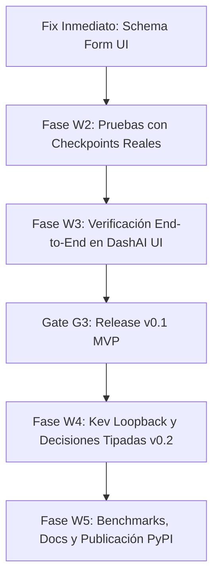

# Roadmap y Tareas Pendientes: `dashai-system-one-plugin`

Este documento consolida el estado actual del proyecto, el diagnóstico del problema detectado en la UI de DashAI y la lista detallada de tareas restantes para completar las versiones **v0.1** y **v0.2** según lo estipulado en `PLAN_ORCA_DASHAI_SYSTEM_ONE.md`.

---

## 1. Estado Actual (Lo completado hasta ahora)

| Componente | Estado | Detalle |
|---|---|---|
| **Auditoría y ADRs (W0)** | ✅ Completado | ADR-001 (Alcance v0.1), ADR-002 (Contrato y probabilidades), ADR-003 (Kev loopback). |
| **Documentación Técnica (W0)** | ✅ Completado | `architecture.md`, `compatibility.md`, `local-models.md`, `benchmark-protocol.md`. |
| **Contratos e Invariantes (W1)** | ✅ Completado | `QuestionSpec`, `DecisionSpec`, `DecisionAnswer`, `DecisionResult` con validación estricta Pydantic V2. |
| **Registro de Checkpoints (W1)** | ✅ Completado | `CheckpointRegistry` inmutable con licencias permisivas verificadas (Apache-2.0 / MIT). |
| **Backends de Inferencia (W1/W2)** | ✅ Completado | `FakeBackend` (deterministic mock), `LayaBackend`, `GLiNERBackend`, `KevBackend` (127.0.0.1 guard). |
| **Adaptadores DashAI (W1/W3)** | ✅ Completado | `DashAISystemOneClassifier` con ciclo de vida completo (`train`, `predict`, `save`, `load`). |
| **Suite de Pruebas Unitarias** | ✅ Completado | 32 pruebas pasando al 100% en `pytest` y linter `ruff` sin advertencias. |
| **Detección en DashAI Core** | ✅ Completado | Componentes reconocidos e instalados en `.venv`: `LayaTextClassifier`, `LayaMultilingualTextClassifier`, `GLiNERDecideTextClassifier`, `GLiNERMultiDecideTextClassifier`, `KevTextClassifier`. |

---

## 2. Diagnóstico y Corrección Inmediata: Pantalla en Blanco en DashAI UI

### Causa Raíz
Al seleccionar el modelo en la interfaz web de DashAI, el frontend solicita el esquema JSON de configuración a través de `/api/v1/component/{NombreModelo}` para renderizar el formulario dinámico.
En `src/dashai_system_one_plugin/models/base_dashai_system_one.py`, los campos estaban definidos como:

```python
# Causa del error:
instruction: Any = schema_field(string_field(), ...)
```

Al utilizar `: Any = schema_field(...)`, Pydantic V2 interpretó el objeto `schema_field` como un **valor por defecto no serializable** en lugar de una anotación de tipo (`Annotated[...]`). Esto generó un esquema JSON desprovisto de tipos y propiedades válidas (`properties: {instruction: {title: "Instruction"}}` sin campo `type` ni `placeholder`), provocando un error de renderizado en React (*TypeError: Cannot read properties of undefined*).

### Solución requerida
Definir los campos de esquema siguiendo el patrón exacto de los plugins nativos de DashAI:

```python
class BaseSystemOneSchema(BaseSchema):
    instruction: schema_field(
        string_field(),
        placeholder="Classify the input text into one of the available categories.",
        alias=MultilingualString(en="Instruction Prompt", es="Instrucción del Prompt"),
        description=MultilingualString(
            en="Natural language guidance for zero-shot decision classification.",
            es="Guía en lenguaje natural para la clasificación de decisiones zero-shot.",
        ),
    )  # type: ignore
    batch_size: schema_field(
        int_field(ge=1),
        placeholder=32,
        alias=MultilingualString(en="Batch Size", es="Tamaño de Lote"),
        description=MultilingualString(
            en="Number of text samples processed together in each batch.",
            es="Número de muestras de texto procesadas juntas en cada lote.",
        ),
    )  # type: ignore
    device: schema_field(
        enum_field(enum=["auto", "cpu", "cuda", "mps"]),
        placeholder="auto",
        alias=MultilingualString(en="Compute Device", es="Dispositivo de Cómputo"),
        description=MultilingualString(
            en="Target hardware: auto-detect, CPU, NVIDIA CUDA, or Apple Silicon MPS.",
            es="Hardware objetivo: autodetección, CPU, NVIDIA CUDA o Apple Silicon MPS.",
        ),
    )  # type: ignore
```

---

## 3. Tareas Restantes por Fase



### Fase W2: Verificación de Inferencia con Modelos Reales (Spikes Locales)
- [ ] **Laya Inferencia Real:**
  - Instalar paquete oficial `laya`: `pip install laya`.
  - Descargar checkpoint `convaiinnovations/laya` y `convaiinnovations/laya-multilingual` a la caché local.
  - Probar inferencia local en CPU y Apple Silicon (MPS).
  - Añadir tests de integración con `@pytest.mark.integration`.
- [ ] **GLiNER Inferencia Real:**
  - Instalar paquete oficial `gliner2`: `pip install gliner2`.
  - Descargar checkpoint `fastino/GLiNER2.5-Decide` y `fastino/GLiNER2.5-multi-Decide`.
  - Probar clasificación sobre etiquetas dinámicas y verificar formato de scores.
  - Añadir tests de integración con `@pytest.mark.integration`.
- [ ] **Verificación Offline:**
  - Validar que con la variable de entorno `HF_HUB_OFFLINE=1` o sin conexión a internet, ambos modelos ejecuten inferencia reutilizando la caché sin fallos.

### Fase W3: Integración y Flujo Completo en DashAI UI (Release v0.1)
- [ ] Aplicar el fix de `BaseSystemOneSchema` y reiniciar el servidor de DashAI.
- [ ] Crear un experimento de **Text Classification** en la interfaz web de DashAI:
  1. Subir el dataset `examples/routing_sample.csv`.
  2. Seleccionar columna de texto (`text`) y objetivo categórico (`category`).
  3. Elegir `LayaMultilingualTextClassifier` o `GLiNERMultiDecideTextClassifier`.
  4. Confirmar que el formulario de parámetros (`instruction`, `batch_size`, `device`) carga correctamente sin pantalla en blanco.
  5. Ejecutar el entrenamiento / preparación zero-shot.
  6. Evaluar predicciones y visualizar métricas (Accuracy, Macro-F1).
  7. Exportar / Guardar el modelo (`save`) y recargarlo (`load`).
- [ ] **Criterio Gate G3:** El flujo de Text Classification completa exitosamente desde la UI sin modificaciones en el núcleo de DashAI.

### Fase W4: Integración de Kev y Decisiones Tipadas (Release v0.2)
- [ ] **Runtime Local de Kev:**
  - Configurar proceso servidor loopback en `http://127.0.0.1:8000` con pesos `jaredpalmer/kev-0.8b` (base Qwen + adaptador).
  - Implementar script supervisor en `utils/kev_process_manager.py` para levantar y apagar el subproceso limpiamente sin procesos zombi.
  - Testear endpoints `/health` y `/decide` bajo condiciones de alta carga y timeout.
- [ ] **Soporte Multi-Pregunta Extendido:**
  - Exponer soporte para resolver simultáneamente preguntas de tipo `choice`, `score` y `noul` en un solo estado textual.
  - Evaluar la viabilidad de registrar una tarea especializada `SystemOneTask` en DashAI si la comunidad lo aprueba.
- [ ] **Criterio Gate G4:** Inferencia de Kev 100% aislada en loopback sin fuga a servicios externos.

### Fase W5: Benchmarks, Documentación y Publicación PyPI
- [ ] **Ejecución de Benchmarks (`docs/benchmark-protocol.md`):**
  - Medir latencia fría vs. caliente (p50, p95), throughput (`muestras/seg`) y consumo de memoria RAM/VRAM en CPU y MPS.
  - Evaluar calibración (ECE, LogLoss) comparando Laya vs. GLiNER vs. Kev.
- [ ] **Documentación Final:**
  - Tutorial paso a paso con capturas de pantalla de DashAI en `docs/tutorial.md`.
  - Guía de solución de problemas y hardware recomendado en `docs/troubleshooting.md`.
- [ ] **Packaging y Release:**
  - Generar artefactos de distribución (`python -m build`).
  - Validar instalación limpia desde un entorno virtual nuevo.
  - Publicar paquete oficial en PyPI bajo aprobación expresa.

---

## 4. Instrucciones Rápidas de Ejecución

### Para aplicar el fix del formulario y reiniciar DashAI:
```bash
# 1. Modificar src/dashai_system_one_plugin/models/base_dashai_system_one.py
# 2. Reinstalar en modo editable si es necesario:
/Users/diegoolguin/dashai_buildon/DashAI_test/.venv/bin/pip install -e /Users/diegoolguin/orca/projects/dashai-system-one-plugin

# 3. Reiniciar el servidor de DashAI:
cd /Users/diegoolguin/dashai_buildon/DashAI_test
uv run --extra cpu python -m DashAI --no-browser --local-path /Users/diegoolguin/.DashAI_test
```

### Para correr la suite de pruebas unitarias:
```bash
pytest -v
```
