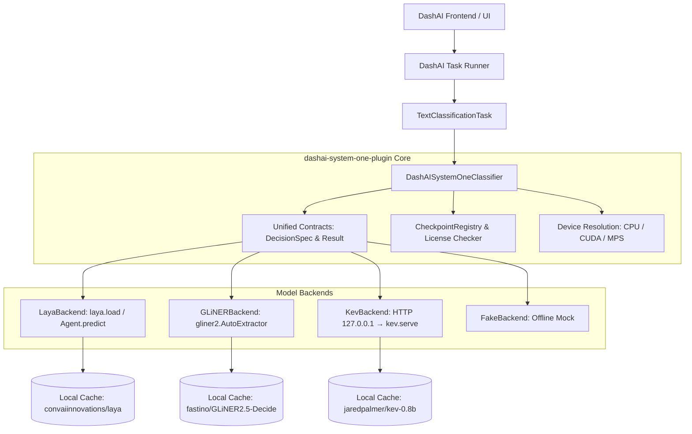

# Arquitectura del Plugin `dashai-system-one-plugin`

## 1. Visión General

`dashai-system-one-plugin` es un plugin modular para DashAI que proporciona soporte de inferencia local para modelos neuronales rápidos de decisiones tipadas ("System One").

A diferencia de los modelos LLM autoregresivos masivos o de modelos de optimización combinatoria, los modelos System One están diseñados para tomar decisiones discretas inmediatas:
- **`choice`**: Clasificación y enrutamiento entre alternativas finitas con probabilidades.
- **`score`**: Evaluación cuantitativa escalar o intensidad de señal.
- **`noul`**: Detección de rechazo, negatividad, ausencia o irrelevancia de una consulta.

## 2. Capas del Sistema

### 2.1 Capa de Contratos (`core/contracts.py`)
Define las estructuras inmutables e independientes de DashAI:
- `QuestionSpec`: Tipo de pregunta (`choice`, `score`, `noul`), instrucciones y criterios/opciones.
- `DecisionSpec`: Entrada textual/estado (`state`) y diccionario de preguntas.
- `DecisionAnswer`: Respuesta a una pregunta individual (valor, probabilidades, calibración).
- `DecisionResult`: Contenedor de todas las respuestas, identificador del modelo y revisión.

### 2.2 Capa de Registro y Caché (`core/checkpoint_registry.py`)
- Lista los checkpoints aprobados con su identificador en Hugging Face, licencia (SPDX), tamaño aproximado y si son multilingües. Es una tabla de consulta (`CheckpointRegistry.get/is_approved/get_license`); no descarga ni verifica archivos.
- La operación sin conexión depende de Hugging Face: tras la primera descarga, `HF_HUB_OFFLINE=1` garantiza que no se intente ninguna conexión (ver `docs/local-models.md`).

### 2.3 Capa de Motores Locales (`backends/`)
Implementa la interfaz `BaseSystemOneBackend`:
- `load(checkpoint_id, revision, device)`
- `predict(decision_spec)`
- `unload()`
- `capabilities()`

Cada backend gestiona los errores específicos de su biblioteca subyacente y los normaliza a los errores tipados del plugin (`BackendMissingError`, `InferenceError`, `UnsupportedQuestionError`, `SecurityError`, etc.).

### 2.4 Capa de Integración DashAI (`models/`)
Hereda de `DashAI.back.models.base_model.BaseModel`:
- Registra esquemas con `BaseSchema` y campos bilingües (`MultilingualString`).
- Implementa `train(x_train, y_train)`: Extrae y valida las clases categóricas de la columna de salida.
- Implementa `predict(x)`: Procesa las entradas por lotes (`batch_size`) y genera una matriz NumPy `(N, K)` de probabilidades o indicadores one-hot.
- Implementa `save(path)` y `load(path)`: Serializa metadatos ligeros (nombre de modelo, revisión, clases mapeadas, configuración de dispositivo) evitando duplicar los pesos del modelo en el archivo de guardado de DashAI.

### 2.5 Utilidades (`utils/`) y métricas (`metrics/`)
- `utils/kev_process_manager.py`: arranca, comprueba y detiene el subproceso `kev.serve`, siempre ligado a `127.0.0.1`, con grupo de procesos propio y apagado SIGTERM → SIGKILL.
- `metrics/classification.py`: Accuracy, Macro-F1, Log-Loss, Brier y ECE usadas por `benchmarks/`.

## 3. Cómo habla cada backend con su modelo

| Backend | Llamada | Nota |
|---|---|---|
| Laya | `laya.load(id, device).predict(state, {pregunta: {type, instructions, criteria}})` | Una pasada responde todas las preguntas; la respuesta anida `answers[pregunta]` |
| GLiNER | `AutoExtractor.from_pretrained(id).classify_text(texto, {pregunta: {labels, prompt}})` | Devuelve solo la etiqueta |
| Kev | `POST http://127.0.0.1:<puerto>/v1/systemone` | API compatible con TypeSafe System One; `GET /v1/models` sirve de health-check |
