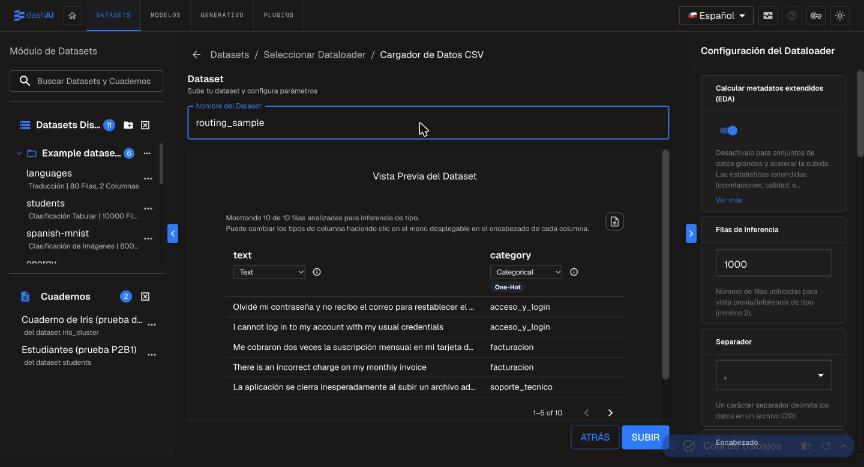
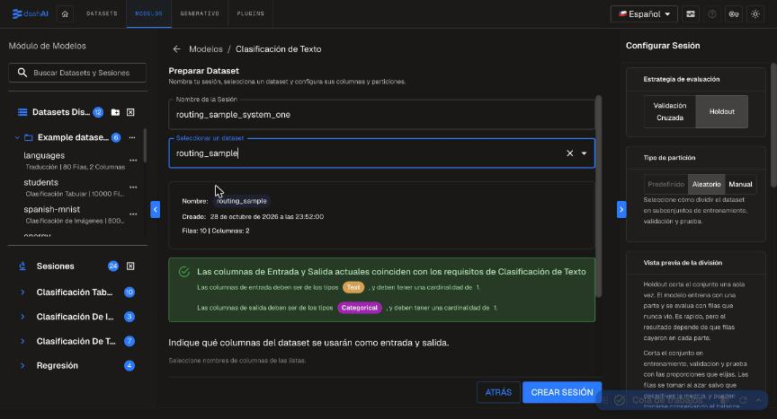
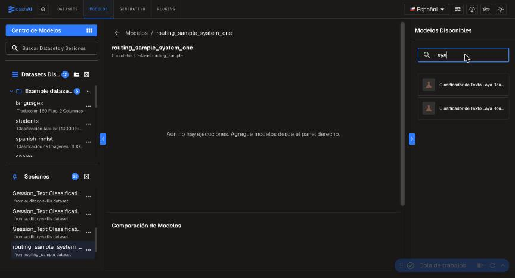
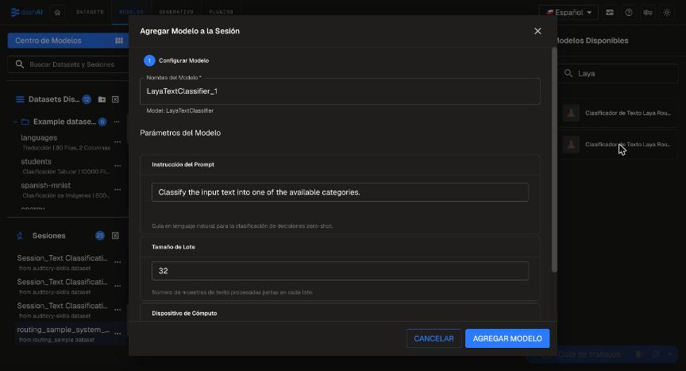
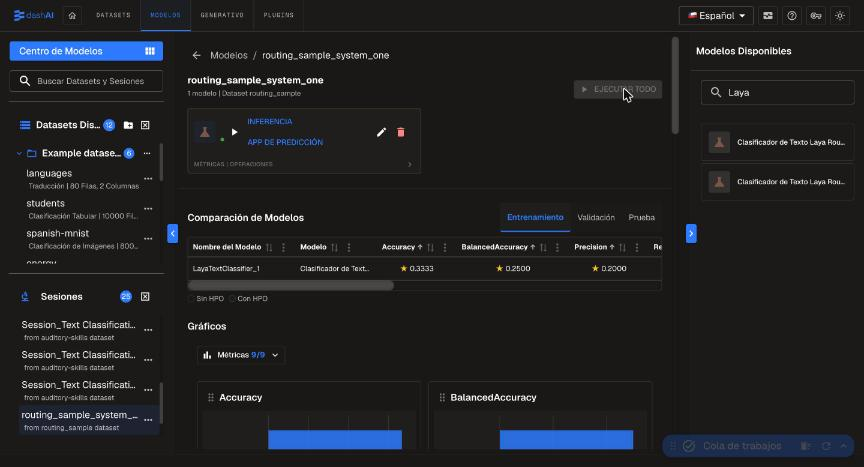

# Tutorial: clasificar texto con System One en DashAI

Este tutorial recorre el flujo completo en la interfaz web de DashAI, con `examples/routing_sample.csv`
(10 mensajes de soporte en español e inglés, 5 categorías). Las capturas son de DashAI 0.10.0.

> Los 10 ejemplos sirven para ver el flujo, no para medir calidad: la métrica que verás es de un split
> minúsculo. Para evaluar de verdad usa tu propio dataset etiquetado (ver
> [benchmark-results.md](benchmark-results.md) para cifras sobre un dataset de 300 muestras).

## 0. Requisitos e instalación

Instala el plugin **en el mismo entorno que DashAI**, junto con los motores que vayas a usar:

```bash
# desde el entorno de DashAI
pip install "dashai-system-one-plugin[all]"      # DashAI + Laya + GLiNER
# o, desde el repositorio:
pip install -e ".[all]"
```

Inicia DashAI con ese mismo intérprete (no uses `uv run`, que puede desinstalar paquetes añadidos a mano):

```bash
python -m DashAI --no-browser
```

En el log debe aparecer `Se cargaron 5 plugins instalados`; la interfaz queda en http://127.0.0.1:8000.
La primera vez que uses un modelo se descargan sus pesos (unos cientos de MB a ~2 GB); después funciona sin
conexión (ver [local-models.md](local-models.md)).

## 1. Subir el dataset

En **Datasets → Dataset → Cargador de Datos CSV**, ponle un nombre (`routing_sample`) y sube
`examples/routing_sample.csv`. La vista previa debe mostrar `text` como *Text* y `category` como
*Categorical*.



Pulsa **Subir** y espera a que el trabajo "Dataset: routing_sample" termine en la cola de trabajos.

## 2. Crear la sesión de Text Classification

En **Modelos → Clasificación de Texto**, nombra la sesión y elige el dataset. DashAI valida que las columnas
cumplan la tarea: entrada de tipo *Text* y salida *Categorical*. Con `text` y `category` ya seleccionadas,
pulsa **Crear sesión**.



## 3. Elegir el modelo

En el panel derecho, busca `Laya` (o `GLiNER`). Los modelos del plugin aparecen con el nombre
"Clasificador de Texto …":



| En el catálogo | Clase | Cuándo usarlo |
|---|---|---|
| Laya (EN) | `LayaTextClassifier` | inglés, devuelve probabilidades (sin calibrar) |
| Laya multilingüe | `LayaMultilingualTextClassifier` | español u otros idiomas |
| GLiNER Decide (EN) | `GLiNERDecideTextClassifier` | inglés, solo etiqueta |
| GLiNER multi Decide | `GLiNERMultiDecideTextClassifier` | multilingüe, solo etiqueta |

## 4. Configurar y ejecutar

Al elegir un modelo se abre el formulario de parámetros:



- **Instrucción del Prompt:** guía en lenguaje natural para la clasificación zero-shot.
- **Tamaño de Lote:** se conserva por compatibilidad; actualmente no cambia la velocidad (las muestras se
  procesan una a una).
- **Dispositivo de Cómputo:** `auto`, `cpu`, `cuda` o `mps`. Si el dispositivo pedido no existe, cae a CPU.

Pulsa **Agregar modelo** y luego **Ejecutar todo**. No hay entrenamiento real: el modelo es zero-shot, así que
"entrenar" solo registra las etiquetas de la columna de salida y carga el modelo en memoria.

## 5. Ver las métricas

Al terminar, DashAI muestra las métricas del modelo (Accuracy, BalancedAccuracy, Precision…) y los gráficos
comparativos:



DashAI guarda la ejecución con `save()`: un JSON pequeño con el nombre del modelo, la instrucción, el
dispositivo y las clases, **sin duplicar los pesos**. Se recarga con `load()` y funciona sin conexión:

```python
from dashai_system_one_plugin.models.laya_text_classifier import LayaTextClassifier

model = LayaTextClassifier.load("/ruta/a/tu/.DashAI/runs/30")  # archivo de la ejecución guardada
probs = model.predict(["Me cobraron dos veces la suscripción"])
print(model.class_names[probs.argmax(axis=1)[0]])        # facturacion
```

## 6. Qué hacer a continuación

- Compara varios modelos en la misma sesión: DashAI los muestra lado a lado.
- Mide sobre tus datos antes de automatizar nada; los modelos son zero-shot y las probabilidades de Laya no
  están calibradas.
- Si algo no funciona, [troubleshooting.md](troubleshooting.md).
